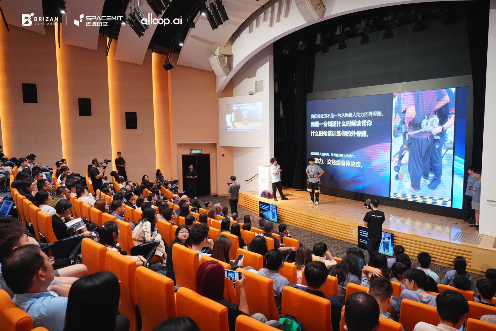
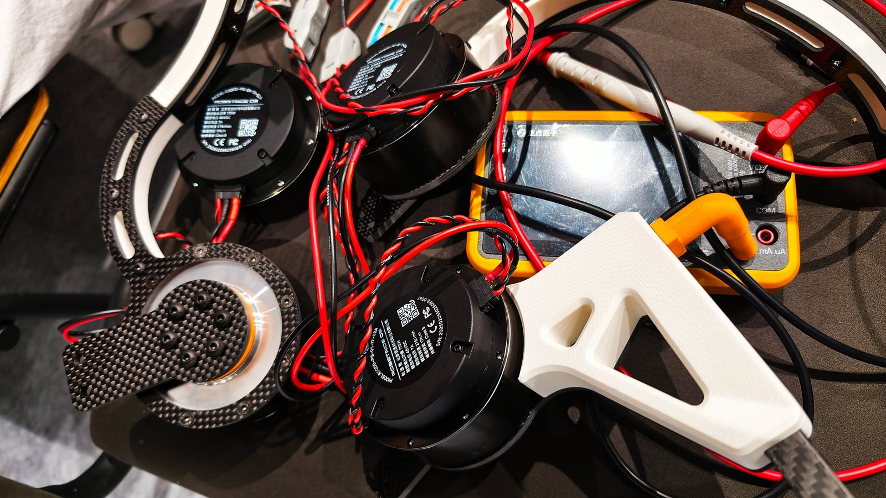
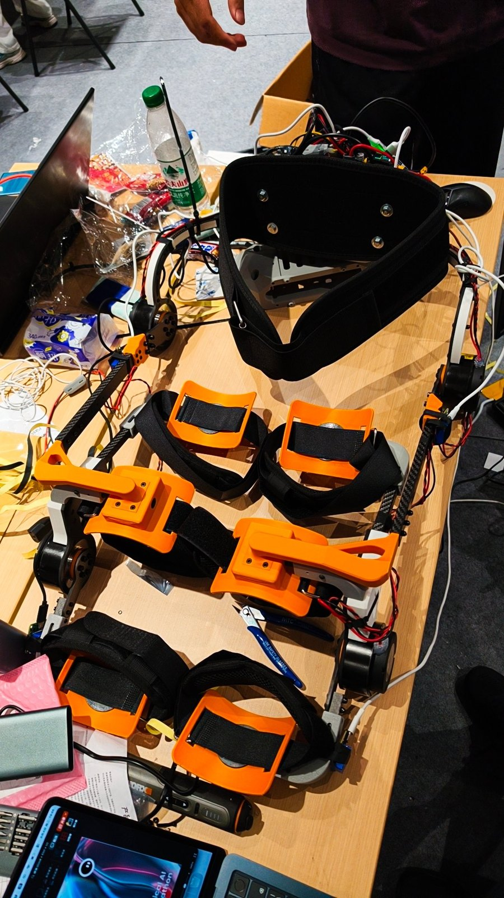
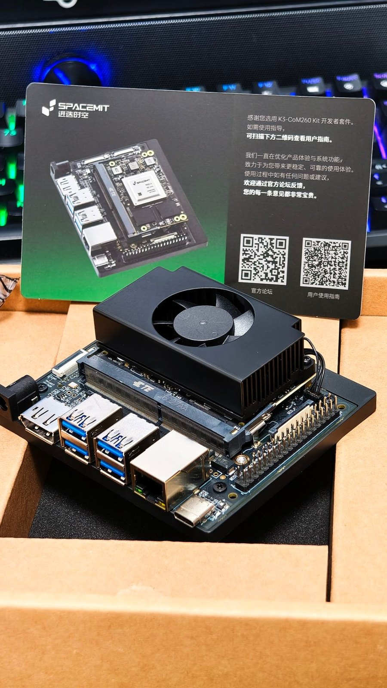

# G-Exo

**Ghost-Exoskeleton** — a Physical AI Hackathon project

> 🏆 **Winner, alloop Track — Hong Kong's first Physical AI Hackathon 2026** (2026-08-05, Hong Kong Science Park)
>
> 🦾 A consumer-grade, four-active-DOF lower-limb exoskeleton for outdoor hiking assistance
>
> **SENSE THE BODY · DECIDE THE ASSIST**

[](LICENSE)

**English** | [中文](README_zh.md)

---

## Result

| | |
|---|---|
| Event | Hong Kong's first Physical AI Hackathon 2026 (initiated by SpacemiT × Brizan Ventures × alloop.ai) |
| Final | 2026-08-05 · K.C. Wong Conference Centre, Hong Kong Science Park · 37 teams / 160+ developers |
| Award | **alloop Track Champion** |
| Entry | G-Exo (Ghost-Exoskeleton) — a four-DOF lower-limb exoskeleton with an Alloop Ring physiological state loop |
| Team | AAA G-Exo (5 people: systems architecture / motion control / SLAM / reinforcement learning / embedded / full-stack) |

**Why the alloop track**: the brief was to turn the ring's sleep, HRV and activity data into an actual judgement of *how the wearer is doing* and act on it, rather than leaving it as a dashboard. G-Exo's answer — **the ring understands the person's state, the exoskeleton understands the person's motion, and Physical AI closes that loop on the body**.

- Demo video: [We built a four-DOF reinforcement-learning exoskeleton at the Physical AI Hackathon — track champion](https://www.bilibili.com/video/BV1uuu36uEjx/) (Bilibili)
- Event coverage: [Hong Kong's first Physical AI Hackathon concludes](https://www.elecfans.com/d/8207944.html)

### Photos

| Final pitch | Exoskeleton under construction |
|---|---|
|  |  |
| **As it looked at the end of the event** | **Sponsored K3 host board** |
|  |  |

---

## Project status

| Milestone | State | Date |
|---|---|---|
| Product definition Q&A | ✅ 5 rounds converged (see [Q&A.md](Q&A.md), Chinese) | 2026-06-28 |
| BOM | ✅ [V2.2, RS02 quasi-direct-drive](1.hardware/BOM.md) (~¥4,611) | 2026-07-30 |
| Actuator procurement | ✅ RobStride RS02 ×5 purchased | 2026-07-30 |
| Mechanical design | ✅ Single frozen revision (SolidWorks assembly + URDF + STL) | 2026-08 |
| Prototype assembly | ✅ Printed parts finished, carbon parts outsourced, unit assembled and run | 2026-08 |
| IMU driver | ✅ ROS 2 + Mahony AHRS, four G354 units at 200 Hz | 2026-07-23 |
| RL training framework | ✅ Kinesis PPO + TCN encoder (160-D observation during training, 4-D action, 1M transitions) | 2026-08-09 |
| Simulated assist validation | ✅ MuJoCo + MyoSuite A/B demo (zero assist vs. assist, matched seed) | 2026-07-27 |
| Policy evaluation | ✅ 10-seed randomised holdout + 3-pair paired evaluation (see below) | 2026-08-09 |
| Sim2Sim audit | ✅ MyoAssist → Kinesis transfer, 9/9 passed (MPJPE delta 1.58 mm) | 2026-08-09 |
| On-device deployment | ✅ Web agent, local LLM and telemetry verified on K3 Pico-ITX / CoM260 | 2026-08-02 |
| Alloop Ring loop | ✅ Ring BLE → Android app (AlloopCore SDK) → WebSocket bridge → system, verified on hardware | 2026-08 |
| Product site | ✅ Bilingual site (`2.software/gexo_web_agent/website`) | 2026-08 |
| On-body control metrics | 🚧 Not yet archived (see [Known gaps](#known-gaps)) | — |

---

## Key specifications

- **DOF**: 4 active (hip flexion/extension ×2 + knee flexion/extension ×2) + 2 passive (coronal abduction/adduction)
- **Mass**: ≤4 kg (excluding battery)
- **Actuators**: RobStride RS02 quasi-direct-drive QDD ×4 (7.75:1 reduction, 6 Nm rated / 17 Nm peak, CAN + MIT torque mode, Φ58 mm, 405 g)
- **Sensors**: 4× Epson G354 automotive-grade IMU (two thigh, two calf) + 4× 14-bit absolute magnetic encoders
- **Power**: 6S 5000 mAh LiPo (22.2 V nominal, ~111 Wh), **single pack + BMS**, DC5525 connector; 30–100 W system, ~10 W standby (~11 h standby runtime)
- **BOM**: ~¥4,611 (target ≤¥5,000)
- **Compute**: SpacemiT K3 (RISC-V) — NPU (TCN INT8 inference <5 ms) + multicore CPU + RT Linux
- **Control**: RL + TCN temporal encoder, task-agnostic (no task classifier, no gait-phase detector)
  - Approach follows the task-agnostic control paradigm of [Molinaro et al., *Nature* 2024](https://doi.org/10.1038/s41586-024-08157-7)
  - Training: MyoSuite 80-muscle human + MuJoCo physics + PPO (Stable-Baselines3)
  - Deployment: TCN INT8 → K3 NPU → RT Linux 50 Hz closed loop → CAN MIT torque commands
- **Two interaction modes**
  - **Adaptive Assist**: hip and knee share the assist torque during fatigue, long hikes, climbing and jogging; global assist ratio 30%–100% in 10% steps
  - **Damping / resistance training**: when recovery is good and the goal is training, the motors switch to damping/protective mode to provide resistance — no extra control model needed
- **Use cases**: outdoor hiking (primary), jogging, climbing, stairs

See [Q&A.md](Q&A.md) and [BOM V2.2](1.hardware/BOM.md) for the full parameter set (both Chinese).

---

## System architecture

```
┌──────────── Sensing: two time scales ─────────────┐
│ Alloop Ring   HR / HRV / SpO2 / activity + 14-day │  → how is the wearer doing today?
│               personal baseline                   │
│ Ring BLE → Android app → WebSocket bridge         │
│               (verified on hardware)              │
│                                                   │
│ G-Exo body    4× IMU + 4× encoder @200 Hz         │  → what does the wearer intend to do?
│               stepping / push-off / knee flexion  │
└─────────────────────────┬─────────────────────────┘
                          ▼
              Decision: state × intent → strategy
        under-recovered + long hike → Adaptive Assist ↑
        well-recovered  + training  → Damping mode
                          ▼
┌──────────────── Control: task-agnostic RL ────────┐
│ 36 features/frame × 200 Hz sensor history          │
│   → TCN temporal encoder (5 dilated conv layers,   │
│     NPU INT8 quantised)                            │
│   → shared latent representation                   │
│   → PPO policy (MLP 128-64) → 4-D normalised       │
│     torque ∈ [-1, 1]                               │
│   → scale → rate limit → low-pass → CAN → RS02     │
│   50 Hz control loop · TCN INT8 inference <5 ms    │
└────────────────────────────────────────────────────┘
```

> During training (Kinesis) the observation is 160-D = 144-D sensor history + 16-D explicit TCN
> prediction; deployment uses the shared-latent interface shown above. See
> [`RL/KINESIS_EXO_TRAINING.md`](RL/KINESIS_EXO_TRAINING.md) (Chinese).

**Sim-to-Real pipeline**

| Phase | Content | State |
|---|---|---|
| Phase 1 | Supervised TCN pre-training (mocap data + OpenSim inverse-dynamics labels); predicts hip/knee angle, angular velocity and biological joint moment 100/200 ms ahead | ✅ 200 ms TCN beats mean and constant-velocity baselines on nine holdout episodes |
| Phase 2 | PPO policy training (MyoSuite 80-muscle human + MuJoCo); reward = muscle-activation reduction against a same-state zero-assist reference + one-sided muscle-torque constraint + balance/safety gates | ✅ 1M transitions, 8 parallel envs, ±6 Nm action scale |
| Phase 3 | K3 deployment → on-device tuning | ✅ K3 link verified on hardware |

Evaluation protocol and commands: [`RL/TCN_PIPELINE.md`](RL/TCN_PIPELINE.md),
[`RL/KINESIS_EXO_EVALUATION.md`](RL/KINESIS_EXO_EVALUATION.md).

**Policy effectiveness (simulation, from `RL/evidence/`)**

Final PPO policy under deterministic paired evaluation against a same-state zero-assist reference,
over 10 randomised holdout seeds (all succeeded):

| Metric | Mean | Range | Target | Verdict |
|---|---|---|---|---|
| Success rate | **10/10** | — | 100% | ✅ |
| Human joint torque saving | **13.6%** | 12.33 – 15.16% | ≥3% | ✅ |
| Gross load saving | **2.51%** | 2.31 – 2.67% | — | — |
| Muscle activation saving | **0.43%** | 0.28 – 0.61% | ≥5% | ❌ not met |
| Mean absolute exo torque | 2.89 Nm | 2.82 – 2.94 Nm | — | — |

**This must be stated plainly**: by the project's own criterion in
[`RL/KINESIS_EXO_EVALUATION.md`](RL/KINESIS_EXO_EVALUATION.md) — an activation drop of ≥5% and a
muscle-torque drop of ≥3% — a policy that misses the target "may only be used to validate the
pipeline and must not claim to meet exoskeleton assistance requirements". **Activation dropped only
0.43%, well short of 5%**, so this project does **not** claim to have demonstrated metabolic-effort
reduction in simulation. The torque side (13.6%, stable across 10/10 seeds) shows the control chain
and load-sharing mechanism work, but the muscle-activation benefit still needs more training and
on-body validation.

Supporting evidence: the MyoAssist → Kinesis Sim2Sim audit passed 9/9 (mean MPJPE delta 1.58 mm
against a 15 mm tolerance); the TCN multi-seed aggregate reports
`ready_for_myo_rl_prototype: true` (normalised MSE cross-seed CV 2.2%).

---

## Conversational LLM control interface

Bending over a phone while wearing an exoskeleton is awkward, and preset levels cannot see live
state — so the interface is a sentence:

Browser (React cockpit) → FastAPI (intent parsing + safety checks) → ROS 2 topic → control node.

- The LLM only parses intent and **never drives the motors directly**; exactly four intents: `query_status` / `set_mode` / `adjust_assist` / `document_qa`
- Local inference: llama.cpp + Qwen3.5-0.8B (INT4); model and transcripts never leave the device, works offline
- Safety design (independent of the prompt): assist ratio clamped to K ∈ [0.3, 1.0] with ±0.1 steps · mode changes only while standing still · emergency stop has top priority and sits outside the LLM path · critical commands need confirmation · timeout is failure, never auto-retried · read/write separation
- Extras: RAG how-to Q&A (jieba + FTS5 + BM25), live state push over WebSocket (1 s staleness detection)

Architecture details: [`2.software/gexo_web_agent/README.md`](2.software/gexo_web_agent/README.md).

For deploying the on-device LLM on K3 (llama.cpp / GGUF placement and startup), see SpacemiT's
official documentation: [K3 SDK — AI & Algorithms · LLM](https://www.spacemit.com/community/document/info?lang=zh&nodepath=software/SDK/ros/k3/04-AI%E4%B8%8E%E7%AE%97%E6%B3%95/4.4-LLM.md).

---

## Repository layout

```
G-Exo/
├── README.md                # English overview (this file)
├── README_zh.md             # 中文说明
├── assets/                  # README photos (pitch / build / final unit / K3)
├── Q&A.md                   # 5-round product definition Q&A (Chinese)
├── ppt.md                   # Final pitch deck, 13 pages + 8-page short version (Chinese)
├── frontend_design.md       # Cockpit frontend design (Chinese)
├── main_visual_optimization.md  # Key-visual notes (Chinese)
├── 1.hardware/              # Hardware
│   ├── BOM.md               # Bill of materials V2.2 (~¥4,611)
│   ├── G-exo/               # Frozen mechanical design (SolidWorks assembly, parts, fastener library)
│   └── G-exo_URDF/          # ROS URDF model + STL meshes
├── 2.software/              # Software
│   ├── imu_driver/          # 4× G354 IMU + Mahony AHRS (ROS 2, 200 Hz)
│   ├── gexo_web_agent/      # On-board web agent (FastAPI + WebSocket + local LLM + React cockpit + product site)
│   ├── voice_tools/         # Voice-control test scripts
│   └── alloop/              # Alloop kit usage-scope notice (kit code not distributed)
├── RL/                      # Reinforcement-learning training framework (Kinesis PPO + TCN)
│   ├── env/                 # Kinesis / MyoSuite environments, sensors, torque actuator, reward
│   ├── runners/             # Training / evaluation / replay / calibration entry points
│   ├── assets/              # TCN calibration, MyoSuite models, dataset manifests
│   ├── deploy/              # K3 deployment (ONNX + SHA256 verification + replay test)
│   ├── evidence/            # Training and evaluation evidence (PPO pairs, 10-seed holdout, sim2sim, TCN)
│   ├── datasets/            # How to obtain the dataset (not bundled — see its README)
│   └── output/              # Demo artifacts (demo_7_27 etc.)
├── control/                 # On-device control (C++17 + ROS 2, RS02 CAN/MIT torque control)
├── 3.paper/                 # Reference papers
├── 4.document/              # Hardware documentation (K3 260com kit / RS02 manuals)
└── deploy/k3/               # K3 on-board deployment notes (how to obtain the SpaceMIT SDK)
```

> Training-run directories (`RL/outputs/`, `RL/papers/`), the training dataset itself, the Alloop
> kit and the K3 SDK are **not distributed** with this repository, either because of size or
> third-party licensing. The dataset is documented in
> [`RL/datasets/README.md`](RL/datasets/README.md); ignore rules are in [.gitignore](.gitignore).

### Training data

The TCN and PPO models are trained on the public dataset released with the task-agnostic control
work this project builds on:

- Download: <https://repository.gatech.edu/entities/publication/a9341fbd-33c4-43e8-878d-a44cf9e99c75> · DOI [10.35090/gatech/75759](https://doi.org/10.35090/gatech/75759) · handle [1853/75759](https://hdl.handle.net/1853/75759)
- Files: `readme.txt` (26.42 KB), `Phase1And2_Complete.zip` (25.34 GB), `Phase1And2_Parsed.zip` (18.76 GB), `Phase3_Complete.zip` (11.74 GB), `Phase3_Parsed.zip` (8.93 GB)
- Dataset page: [Georgia Tech EPIC Lab](https://www.epic.gatech.edu/task-agnostic-exoskeleton-control-via-biological-joint-moment-estimation-dataset/)

Subjects are split by phase and never shared across them; see
[`RL/datasets/README.md`](RL/datasets/README.md) for the split table and placement instructions.

---

## Known gaps

This project was built inside a 48-hour hackathon. The repository records the actual state of
completion, so that simulation results are not mistaken for on-body ones:

- **Simulation ≠ on-body physiology**: the assist validation under `RL/output/` and `RL/evidence/` runs on MuJoCo + MyoSuite under a reproducible functional test condition (55% muscle strength). URDF zero positions and the real motor operating envelope are not yet calibrated, so **nothing here constitutes a claim about real metabolic cost or clinical effect**.
- **The earlier oracle assist controller used simulation-privileged quantities** (it read the previous step's muscle generalised torque). It served only as a physics-interface check and an upper bound, and **cannot be deployed**; the deployable path is TCN estimation → PPO actor.
- **Power supply follows the pitch deck**: this README and `ppt.md` use the final "6S 5000 mAh single pack + BMS"; [`BOM.md`](1.hardware/BOM.md) still describes the earlier "6S 3000 mAh ×2 hot-swap" plan and has not been back-ported.
- **On-body control metrics are still missing**: every effort-saving figure in `RL/evidence/` comes from simulated paired evaluation. The on-body exceedance ratio for the 6 Nm rated torque and real worn effort savings are not archived yet.
- **Two driver directories are dangling submodule references**: `ess_imu_driver2` and `G354_Attitude-algorithm` are recorded as commit objects in git, but the repository has no `.gitmodules`, so a fresh clone cannot check them out.
- **Earlier commits in this repository contain absolute paths**: the sanitisation done for public release covers the current working-tree contents only — no Linux user home directories, no Windows user profile paths, no LAN IPs and no hostnames remain. Older commit objects may still reveal the original local paths through `git log -p`.

---

## License

- Project code (our own parts) is released under the [MIT License](LICENSE).
- Copyright of third-party components, vendor material and papers bundled here is listed in [THIRD_PARTY_NOTICES.md](THIRD_PARTY_NOTICES.md).
- Alloop kit code is **not included** in this public repository (kept locally) because of its
  restricted third-party licence; the permitted scope (hackathon participants, during the event and
  within the scope of the entry; no redistribution without written permission) is described in
  [2.software/alloop/README.md](2.software/alloop/README.md).
